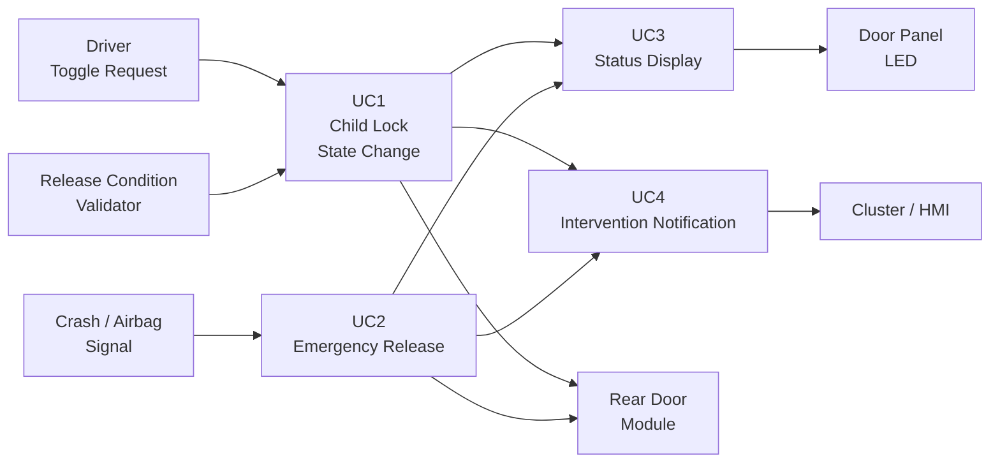
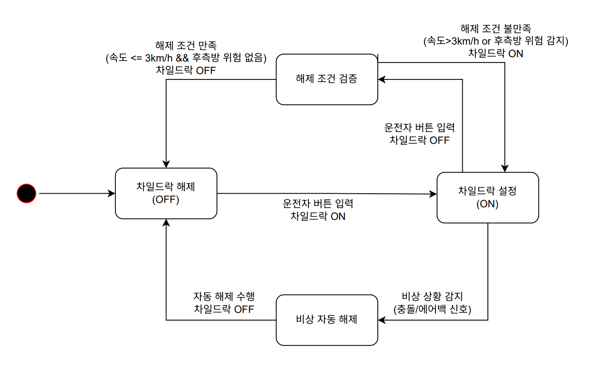
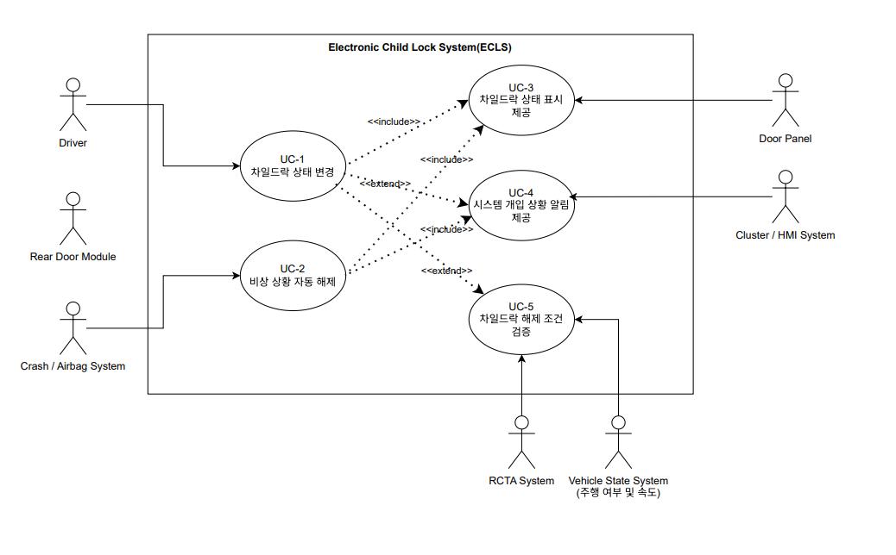

# Electronic Child Lock Simulator

[](https://github.com/hyeongminChoi/MBP-T01-ChildLock/actions/workflows/ci.yml)
[](https://github.com/hyeongminChoi/MBP-T01-ChildLock/wiki)

> **ISO 26262 기능안전 개발 프로세스를 기반으로 전자식 차일드락의 상태 제어와 비상 상황 대응을 구현한 C 기반 시뮬레이터**

현대모비스 MOBIUS SW 부트캠프에서 진행한 3인 팀 프로젝트입니다.

차일드락의 상태 변경, 비상 상황 자동 해제, 상태 표시, 시스템 개입 알림 기능을 Use Case 단위로 설계하고 구현했습니다.
요구사항 정의부터 SW 설계, 구현, 단위 테스트, 정적 분석 및 CI까지 **SW Development Life Cycle 전 과정을 경험하는 것**을 목표로 진행했습니다.

> 자세한 요구사항, 설계 과정 및 개발 문서는 **[GitHub Wiki →](https://github.com/hyeongminChoi/MBP-T01-ChildLock/wiki)** 에서 확인할 수 있습니다.

---

## 1. Project Overview

| 항목          | 내용                                 |
| ----------- | ---------------------------------- |
| 프로젝트        | Electronic Child Lock Simulator    |
| 과정          | 현대모비스 MOBIUS SW 부트캠프               |
| 인원          | 3명                                 |
| 역할          | **Team Leader**                    |
| 담당          | 요구사항 약 70% / 아키텍처 약 33% / 구현 약 33% |
| Language    | C17 / C++17 (Unit Test)            |
| Environment | Ubuntu 24.04 LTS                   |
| Build       | GCC, GNU Make                      |
| Test        | GoogleTest                         |
| CI/CD       | GitHub Actions                     |
| Quality     | Cppcheck, gcov/gcovr, lizard, cloc |

### My Role

* Use Case 기반 요구사항 분석 및 SwRS 작성
* UML 기반 SW 동작 및 아키텍처 설계
* 예외·실패 상황을 고려한 처리 정책 정의
* C 기반 차일드락 제어 로직 구현
* GoogleTest 기반 Unit Test 작성
* GitHub Actions 기반 Quality Gate 적용
* Issue → Branch → PR → Review 기반 협업 프로세스 정립

---

## 2. Problem & Goal

기계식 차일드락과 달리 전자식 차일드락은 차량의 상태와 외부 시스템의 신호에 따라 소프트웨어가 잠금 상태를 결정하고 변경해야 합니다.

따라서 정상적인 잠금/해제뿐 아니라 다음과 같은 상황도 함께 고려했습니다.

* 차일드락 해제 조건을 만족하지 않는 경우
* 차량 충돌 또는 Airbag 전개와 같은 비상 상황
* Rear Door Module의 상태 적용 실패 또는 ACK 미수신
* Door Panel LED 표시 실패
* Cluster/HMI 알림 표시 실패
* 잘못된 상태값 및 유효하지 않은 입력

각 기능을 **Use Case 단위의 독립 모듈**로 분리하고 정상 흐름과 실패 흐름을 함께 정의하여 구현했습니다.

---

## 3. System Overview



외부 장치와의 통신은 callback 기반 dependency interface로 분리했습니다.

이를 통해 제어 로직이 실제 Rear Door Module, Door Panel, Cluster/HMI 구현에 직접 의존하지 않도록 구성하고, 테스트에서는 외부 동작을 대체하여 각 Use Case의 로직을 독립적으로 검증할 수 있도록 설계했습니다.

---

## 4. Use Cases

### UC1. Child Lock State Change

사용자의 차일드락 Toggle 요청을 처리합니다.

```text
Toggle Request
      ↓
Current State 확인
      ↓
Lock / Unlock 결정
      ↓
Unlock인 경우 Release Condition 검증
      ↓
Rear Door Module 상태 적용
      ↓
ACK 확인
      ↓
상태 저장 / 상태 표시
```

주요 처리:

* 현재 Child Lock 상태 조회
* ON/OFF에 따른 Lock/Unlock 동작 결정
* Unlock 시 해제 가능 조건 검증
* 조건 불충족 시 현재 상태 유지 및 알림 요청
* Rear Door Module 상태 적용
* ACK 및 적용 성공 여부 확인
* 최종 Child Lock 상태 저장

**Source**

* [`src/uc1_child_lock_state_change.c`](./src/uc1_child_lock_state_change.c)
* [`src/uc1_child_lock_state_change.h`](./src/uc1_child_lock_state_change.h)
* [`test/uc1_test.cpp`](./test/uc1_test.cpp)

---

### UC2. Emergency Release

차량 충돌 또는 Airbag 전개와 같은 비상 상황에서 차일드락을 자동 해제합니다.

```text
Crash / Airbag Signal
        ↓
Emergency Event 확인
        ↓
Current State 확인
        ↓
Child Lock 강제 OFF
        ↓
Rear Door Module 적용
        ↓
ACK 확인
        ↓
상태 저장 / 운전자 알림
```

주요 처리:

* 비상 이벤트 신호 수신
* 현재 차일드락 상태 확인
* ON 상태인 경우 강제 OFF 결정
* Rear Door Module 상태 변경 요청
* ACK 및 적용 성공 여부 확인
* 최종 상태 저장
* LED 상태 표시 및 시스템 개입 알림 요청

**Source**

* [`src/uc2_emergency_release.c`](./src/uc2_emergency_release.c)
* [`src/uc2_emergency_release.h`](./src/uc2_emergency_release.h)
* [`test/uc2_test.cpp`](./test/uc2_test.cpp)

---

### UC3. Child Lock Status Display

차일드락 상태를 Door Panel LED에 표시합니다.

```text
Child Lock State
       ↓
Input Validation
       ↓
LED Command 결정
       ↓
Door Panel 전송
       ↓
ACK / Display Result 확인
       ↓
Failure Handling
```

주요 처리:

* ON/OFF 상태값 유효성 검증
* 상태에 따른 LED ON/OFF Command 생성
* Door Panel에 LED Command 전송
* ACK 및 실제 표시 성공 여부 확인
* ACK Timeout과 Display Failure 분리 처리

**Source**

* [`src/uc3_child_lock_status_display.c`](./src/uc3_child_lock_status_display.c)
* [`src/uc3_child_lock_status_display.h`](./src/uc3_child_lock_status_display.h)
* [`test/uc3_test.cpp`](./test/uc3_test.cpp)

---

### UC4. System Intervention Notification

차일드락 제어 과정에서 발생한 시스템 개입 정보를 Cluster/HMI에 전달합니다.

지원하는 Intervention Type:

| 상황                    | Notification |
| --------------------- | ------------ |
| Unlock Denied         | Warning      |
| Emergency Auto Unlock | Info         |
| System Fault          | Fault        |

```text
Intervention Event
        ↓
Event Type Validation
        ↓
Notification Type 결정
        ↓
Cluster / HMI 전송
        ↓
ACK / Display Result 확인
        ↓
Failure Logging
```

표시 기능에 문제가 발생하더라도 차일드락 제어 자체에는 영향을 주지 않도록 제어 기능과 알림 기능의 실패 처리를 분리했습니다.

**Source**

* [`src/uc4_system_intervention_notification.c`](./src/uc4_system_intervention_notification.c)
* [`src/uc4_system_intervention_notification.h`](./src/uc4_system_intervention_notification.h)
* [`test/uc4_test.cpp`](./test/uc4_test.cpp)

---

## 5. Design

### 5.1 Use Case 기반 모듈 분리

각 기능을 하나의 거대한 제어 함수에 포함하지 않고 기능별 Use Case로 분리했습니다.

```text
UC1 : Child Lock State Change
UC2 : Emergency Release
UC3 : Child Lock Status Display
UC4 : System Intervention Notification
```

요구사항과 실제 소스 모듈을 동일한 단위로 구성하여 요구사항 → 설계 → 구현 → 테스트 간의 대응 관계를 확인할 수 있도록 했습니다.

---

### 5.2 Dependency 분리

Rear Door Module, Door Panel, Cluster/HMI와 같은 외부 시스템 호출은 callback으로 주입받도록 구현했습니다.

```c
typedef struct
{
    bool (*applyStateToRearDoorModule)(...);
    bool (*checkRearDoorModuleAck)(...);
    void *context;
} Dependencies;
```

이를 통해 핵심 제어 로직과 외부 I/O를 분리하고, Unit Test에서 외부 장치의 동작을 독립적으로 제어할 수 있도록 구성했습니다.

---

### 5.3 Failure Path 명시

정상 동작만 구현하지 않고 시스템에서 발생할 수 있는 실패 상황을 별도의 흐름으로 처리했습니다.

예를 들어 다음 상황을 검증합니다.

```text
Invalid Input
ACK Timeout
State Apply Failure
Display Failure
Missing Dependency
NULL Pointer
Unlock Condition Rejected
```

각 실패 상황에 대해 상태 유지, 오류 반환, 진단 처리 또는 사용자 알림 등 기능별 대응 방식을 정의했습니다.

---

### 5.4 State 기반 제어

Child Lock의 핵심 상태를 `ON / OFF`로 관리하고 입력 이벤트와 현재 상태에 따라 다음 동작을 결정합니다.



[State Diagram 상세 보기 →](./doc/uml_diagram/state)

---

## 6. UML

요구사항 분석 및 SW 설계 과정에서 Use Case, State, Sequence, Flowchart를 활용했습니다.

### Use Case Diagram



상세 UML 자료:

* [Use Case Diagram](./doc/uml_diagram/usecase)
* [State Diagram](./doc/uml_diagram/state)
* [Sequence Diagram](./doc/uml_diagram/sequence)
* [Flowchart](./doc/uml_diagram/flowchart)

설계 과정과 요구사항에 대한 자세한 설명은 **[GitHub Wiki](https://github.com/hyeongminChoi/MBP-T01-ChildLock/wiki)** 에 정리했습니다.

---

## 7. Testing

각 Use Case에 대해 GoogleTest 기반 Unit Test를 작성했습니다.

```text
test/
├── uc1_test.cpp
├── uc2_test.cpp
├── uc3_test.cpp
└── uc4_test.cpp
```

외부 시스템 동작은 callback dependency를 테스트 코드에서 대체하여 다음과 같은 정상/실패 흐름을 검증할 수 있도록 구성했습니다.

* 정상 상태 변경
* 해제 조건 거부
* 비상 자동 해제
* 잘못된 입력
* ACK 미수신
* 상태 적용 실패
* LED 표시 실패
* Cluster/HMI 표시 실패

---

## 8. CI & Quality Gate

Pull Request가 `main` Branch를 대상으로 생성되면 GitHub Actions에서 자동으로 품질 검증을 수행합니다.

```text
Pull Request
     ↓
Build
     ↓
Unit Test
     ↓
Static Analysis
     ↓
LOC Check
     ↓
Complexity Check
     ↓
Function Length Check
     ↓
Comment Ratio Check
     ↓
Coverage Check
```

### Quality Gate

| 항목                    | Tool          |            기준 |
| --------------------- | ------------- | ------------: |
| Build                 | GCC / Make    | Build Success |
| Unit Test             | GoogleTest    |  Test Success |
| Static Analysis       | Cppcheck      |      Error 없음 |
| Cyclomatic Complexity | lizard        |          ≤ 10 |
| Function Length       | Custom Script |    ≤ 80 lines |
| Comment Ratio         | Custom Script |         ≥ 20% |
| Line Coverage         | gcovr         |         ≥ 80% |
| LOC                   | cloc          |   Measurement |

CI 설정:

[`/.github/workflows/ci.yml`](./.github/workflows/ci.yml)

개발 환경:

[`DEVELOPMENT.md`](./DEVELOPMENT.md)

---

## 9. Git Workflow

모든 개발 작업은 Issue를 기준으로 관리했습니다.

```text
Issue
  ↓
Branch
  ↓
Development
  ↓
Commit & Push
  ↓
Pull Request
  ↓
Code Review
  ↓
Squash Merge
  ↓
main
```

### Branch Convention

```text
feature/{issue-number}-{description}
fix/{issue-number}-{description}
refactor/{issue-number}-{description}
docs/{issue-number}-{description}
test/{issue-number}-{description}
chore/{issue-number}-{description}
```

### Commit Convention

```text
feat: ...
fix: ...
refactor: ...
docs: ...
test: ...
```

상세 협업 규칙:

[`GITHUB.md`](./GITHUB.md)

---

## 10. Development Environment

| Category            | Technology       |
| ------------------- | ---------------- |
| OS                  | Ubuntu 24.04 LTS |
| Production Language | C17              |
| Test Language       | C++17            |
| Compiler            | GCC / G++        |
| Build               | GNU Make         |
| Unit Test           | GoogleTest       |
| CI                  | GitHub Actions   |
| Static Analysis     | Cppcheck         |
| Coverage            | gcov / gcovr     |
| Complexity          | lizard           |
| LOC                 | cloc             |
| Version Control     | Git / GitHub     |

---

## 11. Build & Test

### Clone

```bash
git clone https://github.com/hyeongminChoi/MBP-T01-ChildLock.git
cd MBP-T01-ChildLock
```

### Build & Unit Test

```bash
make
```

또는

```bash
make test
```

빌드 결과:

```text
build/unit_tests
```

### Clean

```bash
make clean
```

보다 자세한 개발 환경은 [`DEVELOPMENT.md`](./DEVELOPMENT.md)를 참고하세요.

---

## 12. Repository Structure

```text
MBP-T01-ChildLock
│
├── .github/
│   └── workflows/
│       └── ci.yml
│
├── doc/
│   └── uml_diagram/
│       ├── flowchart/
│       ├── sequence/
│       ├── state/
│       ├── usecase/
│       └── v1/
│
├── scripts/
│   ├── check_comment_ratio.py
│   └── check_function_length.py
│
├── src/
│   ├── child_lock_types.h
│   ├── uc1_child_lock_state_change.c
│   ├── uc1_child_lock_state_change.h
│   ├── uc2_emergency_release.c
│   ├── uc2_emergency_release.h
│   ├── uc3_child_lock_status_display.c
│   ├── uc3_child_lock_status_display.h
│   ├── uc4_system_intervention_notification.c
│   └── uc4_system_intervention_notification.h
│
├── test/
│   ├── uc1_test.cpp
│   ├── uc2_test.cpp
│   ├── uc3_test.cpp
│   └── uc4_test.cpp
│
├── DEVELOPMENT.md
├── GITHUB.md
├── Makefile
└── README.md
```

---

## 13. My Contribution

**Team Leader / 3인 팀**

| 영역                    |    기여 |
| --------------------- | ----: |
| Requirements          | 약 70% |
| Software Architecture | 약 33% |
| Implementation        | 약 33% |

### Requirements

* 요구사항 분석 및 Use Case 구조화
* SwRS 작성 및 요구사항 구체화
* 정상 흐름과 예외/실패 흐름 정의
* 기능 간 관계 및 외부 시스템 Interaction 정의

### Architecture

* UML을 활용한 SW 동작 구조 설계
* State / Sequence / Flowchart 기반 동작 구체화
* 외부 시스템과 핵심 제어 로직의 Dependency 분리
* 예외 및 Failure 발생 시 처리 정책 정의

### Implementation & Test

* C 기반 제어 로직 구현
* GoogleTest 기반 Unit Test 작성
* 정상/비정상 입력 및 Failure Path 검증
* GitHub Actions 기반 자동 품질 검증 적용

### Collaboration

* Issue 기반 업무 관리
* Branch / Commit / PR Convention 정립
* Pull Request 기반 Code Review
* Squash Merge 기반 main Branch 관리
* 주기적인 요구사항 및 설계 문서 Review

---

## 14. What I Learned

### 요구사항에서 코드까지의 연결

기능을 바로 구현하기보다 요구사항과 Use Case를 먼저 정의하고, 이를 설계와 코드 구조까지 연결하는 과정을 경험했습니다.

이를 통해 구현의 기준이 코드 자체가 아니라 **요구사항에서 출발해야 한다는 점**을 배웠습니다.

### Failure를 포함한 설계

정상 동작뿐 아니라 ACK 미수신, 잘못된 입력, 상태 적용 실패와 같은 Failure를 요구사항과 설계 단계부터 정의했습니다.

임베디드 SW에서는 기능의 성공 흐름과 함께 **실패했을 때 시스템이 어떻게 동작할지 결정하는 것 역시 중요한 설계 요소**임을 경험했습니다.

### 측정 가능한 코드 품질

코드 품질을 개발자의 판단에만 맡기지 않고 Complexity, Function Length, Coverage 등의 기준을 수치화하여 CI에서 자동으로 검증했습니다.

이를 통해 팀이 동일한 품질 기준을 공유하고 Pull Request 단계에서 지속적으로 확인하는 개발 프로세스를 구축했습니다.

---

## 15. Documentation

프로젝트의 상세 요구사항과 설계 문서는 GitHub Wiki에서 확인할 수 있습니다.

### [GitHub Wiki 바로가기 →](https://github.com/hyeongminChoi/MBP-T01-ChildLock/wiki)

Repository Documents:

* [Development Environment](./DEVELOPMENT.md)
* [GitHub Workflow](./GITHUB.md)
* [Use Case Diagram](./doc/uml_diagram/usecase)
* [State Diagram](./doc/uml_diagram/state)
* [Sequence Diagram](./doc/uml_diagram/sequence)
* [Flowchart](./doc/uml_diagram/flowchart)

---

## Team

| Name    | Role            |
| ------- | --------------- |
| **최형민** | **Team Leader** |
| 권승회     | Team Member     |
| 염시후     | Team Member     |

---

> **Note**
> 본 프로젝트는 기능안전 SW 개발 프로세스 학습을 목적으로 구현한 교육용 시뮬레이터이며, 실제 양산 차량 ECU 또는 ISO 26262 인증 제품이 아닙니다.
